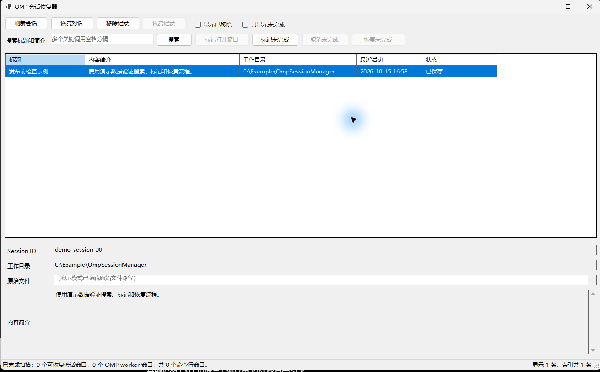

# OMP Session Manager / OMP 会话恢复器

一个面向 Windows 的本地桌面工具，用于查看、搜索、标记和恢复 OMP 会话。它不会上传会话内容；所有扫描、索引和恢复操作都在本机完成。



## 中文

### 功能

- 扫描 OMP 的 JSONL 会话文件，显示标题、摘要、工作目录、最近活动时间和状态。
- 按标题或摘要进行不区分大小写的多关键词 AND 搜索；`*关键词*` 也可作为包含匹配使用。
- 标记、筛选和批量恢复“未完成”会话；“移除记录”只隐藏管理器索引，不会删除原始会话。
- 通过 `omp.exe --resume=<session-id>` 恢复单个或多个会话。
- 识别当前用户桌面上的命令行窗口，并以标题和唯一工作目录名辅助标记已打开会话。

### 安装与运行

1. 在 GitHub Release 下载与版本匹配的 `OmpSessionManager-Setup-<版本>.exe`。
2. 同时下载同名 `.sha256` 文件，按 [安装与使用说明](docs/安装与使用.md) 校验哈希。
3. 运行安装程序；默认安装到当前用户的 LocalAppData 程序目录，无需管理员权限。
4. 若不希望安装，可下载 `OmpSessionManager-<版本>-win-x64-portable.zip`，解压后运行 `OmpSessionManager.exe`。

当前发布物为 Windows x64、self-contained 版本，不要求预先安装 .NET Desktop Runtime。安装程序当前未进行代码签名，Windows 可能显示来源提示；请只从该仓库的 Release 页面下载，并先验证 SHA-256。

当前公开 Release：`v1.0.0`。

### 快速使用

1. 启动程序后等待首次扫描完成。
2. 使用“搜索标题和简介”定位会话；多个词必须全部命中标题或摘要中的至少一个字段。
3. 选中会话后可恢复、移除记录或添加“未完成”标签。
4. 点击“恢复未完成”前会显示确认对话框；成功启动并不自动清除标签。

默认从 `%USERPROFILE%\.omp\agent\sessions` 读取会话，并优先在 `%LOCALAPPDATA%\omp\omp.exe` 查找 OMP；默认位置不存在时会继续查找 `PATH`。也可使用 `--omp-executable <路径>` 显式指定可执行文件。详细参数与故障处理见 [安装与使用说明](docs/安装与使用.md)。

### 隐私与数据

程序不会复制完整对话或向网络发送遥测数据。为实现列表和恢复功能，它会在本地索引中保存会话 ID、标题、最多 180 个字符的首条用户消息摘要、工作目录、原始文件路径、时间和用户标签。请先阅读 [隐私与数据处理](docs/隐私与数据处理.md)，再让他人访问你的屏幕或索引文件。

README 图片仅使用仓库内完全虚构的演示会话生成，不包含真实账户、工作目录、对话或 Session ID。

### 开发、测试与发布

```powershell
dotnet test .\OmpSessionManager.Tests\OmpSessionManager.Tests.csproj --configuration Release
pwsh -NoLogo -NoProfile -File .\scripts\Invoke-QualityGate.ps1
```

发布流程、UI 演示、安装包和 GitHub Release 自动化见 [发布流程](docs/发布流程.md)；测试层级见 [测试与质量](docs/测试与质量.md)；当前自动更新状态见 [自动更新说明](docs/自动更新.md)。

### 文档索引

- [安装与使用](docs/安装与使用.md)
- [隐私与数据处理](docs/隐私与数据处理.md)
- [架构说明](docs/架构说明.md)
- [测试与质量](docs/测试与质量.md)
- [发布流程](docs/发布流程.md)
- [自动更新说明](docs/自动更新.md)
- [更新日志](CHANGELOG.md)

### 许可证

仓库当前未附开源许可证。公开可见不等同于授予复制、修改或再发布源码的权利；如需开源授权，应由权利人选择并添加许可证。

## English

### What it does

OMP Session Manager is a local Windows desktop utility for discovering, searching, tagging, and resuming OMP sessions. Scanning, indexing, and resume commands stay on the local machine; the application does not upload conversation data.

- Reads OMP JSONL session metadata and presents titles, summaries, workspace paths, timestamps, and state.
- Searches titles and summaries with case-insensitive AND semantics across multiple keywords.
- Keeps removable local records and “incomplete” tags without deleting original session files.
- Resumes a session with `omp.exe --resume=<session-id>`.
- Uses visible command-window titles as a best-effort signal for open sessions.

### Install and use

Download the matching installer and its SHA-256 file from the GitHub Release, verify the hash, and run the installer. A portable ZIP is also available for extract-and-run use. Releases are self-contained Windows x64 builds, so no separate .NET Desktop Runtime is required.

The installer is currently unsigned. Download only from this repository’s Release page and verify the checksum before installation. See the [installation and usage guide](docs/安装与使用.md) for verification, command-line options, and troubleshooting.

Current public Release: `v1.0.0`.

On first launch, wait for the scan to finish, search or select a session, then use the visible actions to resume it or manage its tags. The app tries the default OMP location first and then `PATH`; `--omp-executable <path>` overrides both.

### Quick start

1. Wait for the initial scan to finish.
2. Enter one or more search terms in the search box. Every term must match either the title or summary.
3. Select a session to resume it, remove only its local manager record, or add/remove its incomplete tag.
4. “Resume incomplete” asks for confirmation and does not clear tags merely because a launch was requested.

### Development, testing, and release

```powershell
dotnet test .\OmpSessionManager.Tests\OmpSessionManager.Tests.csproj --configuration Release
pwsh -NoLogo -NoProfile -File .\scripts\Invoke-QualityGate.ps1
```

See the [release workflow](docs/发布流程.md) for packaging and GitHub Release automation, [testing and quality](docs/测试与质量.md) for verification layers, and [automatic-update notes](docs/自动更新.md) for the current update status.

### Documentation

- [Installation and usage](docs/安装与使用.md)
- [Privacy and data handling](docs/隐私与数据处理.md)
- [Architecture](docs/架构说明.md)
- [Testing and quality](docs/测试与质量.md)
- [Release workflow](docs/发布流程.md)
- [Automatic-update notes](docs/自动更新.md)
- [Changelog](CHANGELOG.md)

### Privacy and licensing

The tool does not copy full conversations, but its local index stores session metadata needed for management: ID, title, a first-message summary capped at 180 characters, paths, timestamps, and tags. Review [privacy and data handling](docs/隐私与数据处理.md) before sharing screenshots or local index files.

The screenshot above uses fictional demo data only. This repository currently has no open-source license; public visibility alone does not grant permission to copy, modify, or redistribute the source.
